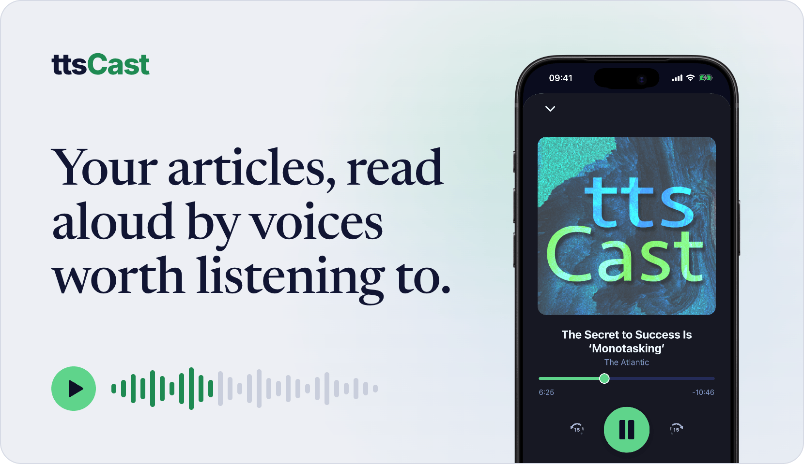
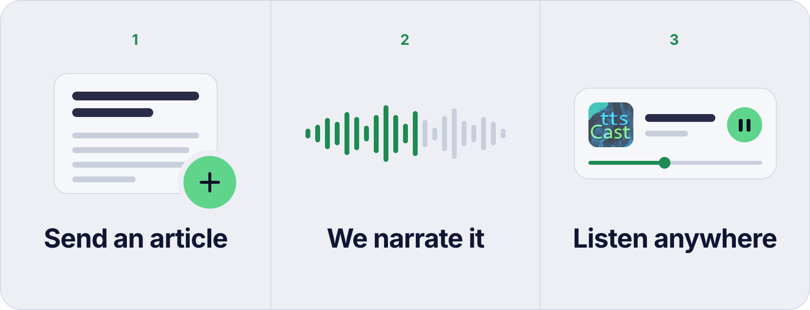
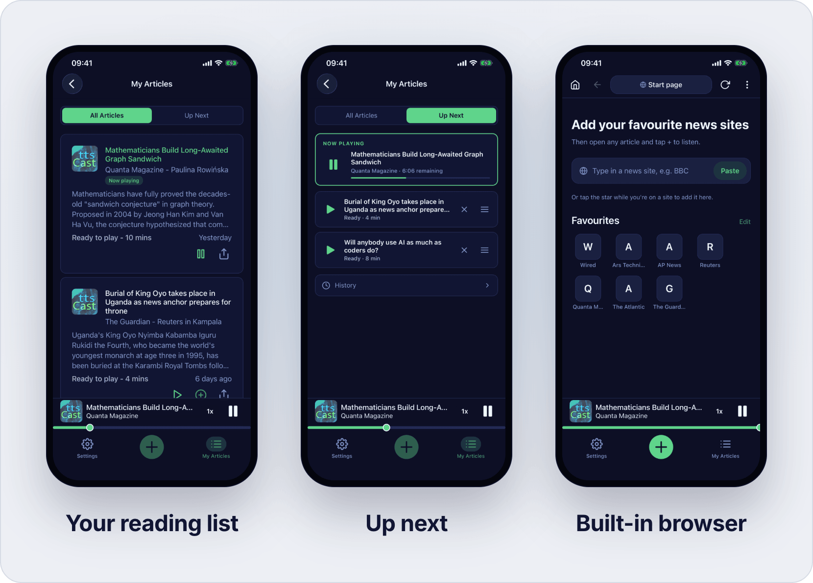

  <a href="https://ttscast.app">
    <picture>
      <source media="(prefers-color-scheme: dark)" srcset="assets/hero-dark.png">
      
    </picture>
  </a>

<h3 align="center">Your reading list, listened to.</h3>

  Send any article to ttsCast and it comes back as a narrated episode, in voices that don't sound like AI. 
  Listen in the app, or in your own podcast player through a private feed.

  <a href="https://ttscast.app"><picture><source media="(prefers-color-scheme: dark)" srcset="assets/button-website-dark.png"></picture></a>
  &nbsp;
  <a href="https://addons.mozilla.org/en-US/firefox/addon/ttscast-helper/"><picture><source media="(prefers-color-scheme: dark)" srcset="assets/button-firefox-dark.png"></picture></a>
  &nbsp;
  <picture><source media="(prefers-color-scheme: dark)" srcset="assets/button-appstore-soon-dark.png"></picture>

 

## How an article becomes a podcast episode

  <picture>
    <source media="(prefers-color-scheme: dark)" srcset="assets/how-it-works-dark.png">
    
  </picture>

1. **Send an article.** Send the page you're reading with one click from the Firefox extension, signed in as you. On iPhone, share from Safari or open pages in the app's built-in browser. You can also paste the text.
2. **We narrate it.** Menus, captions and ads are stripped out, then a large voice model narrates the article in full quality, which takes a few minutes. In a hurry? A faster voice starts streaming within seconds.
3. **Listen anywhere.** Play it in the web app, or subscribe to your private feed in any podcast player you already use.

 

## The iPhone app

  <picture>
    <source media="(prefers-color-scheme: dark)" srcset="assets/screens-dark.png">
    
  </picture>

Coming soon to the App Store. Share from Safari, or browse in a built-in browser that uses your own logins. Line up what's next in a queue, control playback from the lock screen, and set a sleep timer.

 

## What you get

**Voices worth listening to.** Full-quality narration uses large voice models. When you want to listen right away, a faster voice starts streaming within seconds.

**The newspapers you already subscribe to.** Sign in to a site as usual, then send the page. ttsCast gets the article exactly as you see it, so there's nothing to bypass.

**A private podcast feed.** Every account gets one. Add it to Apple Podcasts, Overcast, Pocket Casts or any player that adds shows by URL. Spotify doesn't support private feeds.

**Just the article.** Menus, captions and ads are removed before narration, so you hear the piece and nothing else.

**Free to start.** 60 minutes when you sign up, then 30 minutes every month. No card needed. Plans are sold in minutes of audio, and the details are on the [pricing page](https://ttscast.app/pricing).

 

## Where it works

One account and one feed, wherever you listen.

| Platform | Status |
|:--|:--|
| **Web app** | Available now at [ttscast.app](https://ttscast.app) |
| **Podcast feed** | Available now, included with every account |
| **Firefox** | Available now: [Add to Firefox](https://addons.mozilla.org/en-US/firefox/addon/ttscast-helper/) |
| **iPhone** | Coming soon to the App Store |
| **Chrome** | Coming soon |
| **Android** | Coming later. The web app and your feed work on Android phones today |

 

## About

ttsCast is designed and built by one person, [Jimmy](https://github.com/JimmysDev). If something isn't working or you have a question, [write to support](https://ttscast.app/support) and a human answers.

[Website](https://ttscast.app) · [Pricing](https://ttscast.app/pricing) · [Privacy](https://ttscast.app/privacy) · [Terms](https://ttscast.app/terms) · [Support](https://ttscast.app/support)

© 2026 ttsCast. All rights reserved. This repository is a showcase page and contains no source code; ttsCast is not open source. Article titles and publication names shown in screenshots belong to their respective owners and appear only as items in a reading list. iPhone and App Store are trademarks of Apple Inc. Firefox is a trademark of the Mozilla Foundation.
